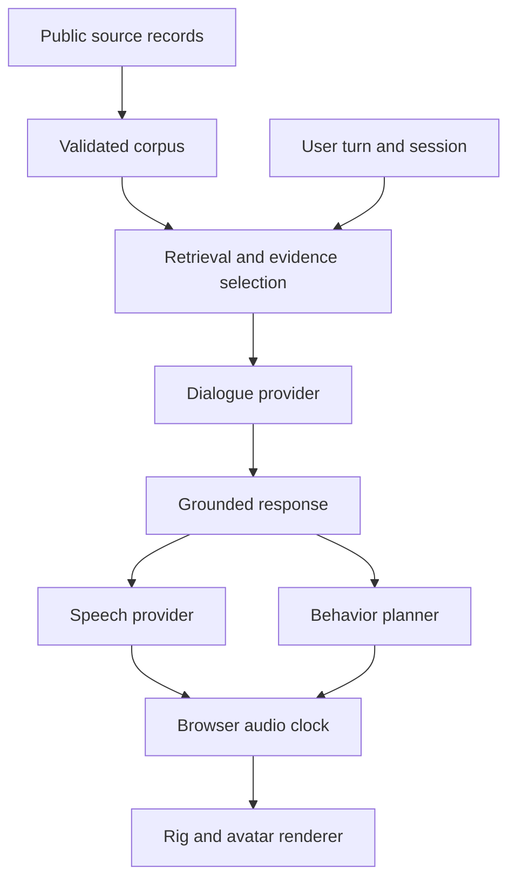

# System architecture

The server owns evidence, prompts, provider credentials, bounded conversation state, and behavioral plans. The browser owns rendering, microphone interaction, audio playback, interruption, and the authoritative playback clock.

## Evidence and generation

Source metadata and short authored paraphrases are versioned separately from private media. Held-out sources are excluded from runtime retrieval. The default no-key mode returns source notes; it is a useful functional preview and not a trained model. Configured generation uses a server-side OpenAI-compatible endpoint and validates the source IDs it returns. Citation validity means the ID belongs to retrieved evidence; it does not prove semantic entailment of every generated sentence.

## Voice and timing

Playback uses audio time where audio bytes exist. Word/phoneme timings are only accurate when a speech provider supplies them. Amplitude-driven jaw motion and browser speech estimates are labeled approximate. Stopping, replacing, or resetting a turn invalidates the previous playback generation so late audio cannot start in a new conversation.

## Behavior and rig

Behavior plans specify channel, start time, duration, intensity, and provenance. The initial planner uses authored demonstration rules. It must not report these as observations about the subject. The avatar exposes independent facial and skeletal controls, supporting both its procedural reference rig and a mapped external GLB. Rendering quality and identity likeness are separate from conversational grounding.

## Deployment boundary

Local development binds to loopback. Keys are environment variables read only by the server. Public hosting additionally needs authentication, quotas, persistence policy, and infrastructure appropriate for speech/vision inference. The repository does not assume that a publicly reachable unauthenticated model proxy is a production deployment.

