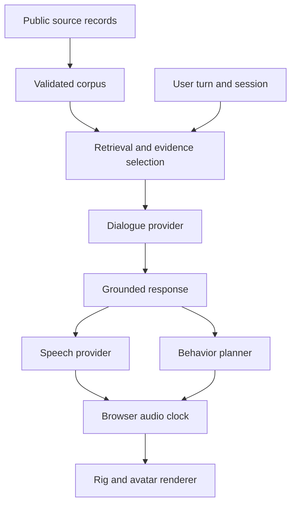

# System architecture

The server owns evidence, prompts, provider credentials, bounded conversation state, and behavioral plans. The browser owns rendering, microphone interaction, audio playback, interruption, and the authoritative playback clock.

## Evidence and generation

Source metadata and short authored paraphrases are versioned separately from private media. Held-out sources are excluded from runtime retrieval. The default no-key mode returns source notes; it is a useful functional preview and not a trained model. Configured generation uses a server-side OpenAI-compatible endpoint and validates the source IDs it returns. Citation validity means the ID belongs to retrieved evidence; it does not prove semantic entailment of every generated sentence.

## Voice and timing

The prepared-speech route synthesizes one clip, optionally runs bounded audio recognition, and binds its mouth-cue document to the audio SHA-256. A bounded, short-lived in-memory cache serves the clip. Browser playback verifies the hash before use and keeps the actual audio clock separate from the behavior-plan clock. Timing provenance distinguishes audio recognition, provider timing, manual timing, and any future forced alignment. Rhubarb predictions, amplitude-driven jaw motion, and browser speech estimates are not phoneme ground truth. Stopping, replacing, or resetting a turn invalidates the previous playback generation so late audio cannot start in a new conversation. HTTP disconnection does not promise immediate cancellation of a provider's underlying synchronous model work; resource limits remain active.

## Behavior and rig

Behavior plans specify channel, start time, duration, intensity, and provenance. The initial planner uses authored demonstration rules. It must not report these as observations about the subject. The avatar exposes independent facial and skeletal controls, supporting both its procedural reference rig and a mapped external GLB. Rendering quality and identity likeness are separate from conversational grounding.

Measured clips use a different source clock and review contract. Geometry previews require explicit activation; reviewed speaker replay requires recorded track continuity, clock, and attribution checks. Frame interpolation respects gaps. Per-channel face measurements and local-delta bone quaternions pass through neutral calibration and source-to-target bases before they reach supported asset controls. Unsupported channels are diagnosed. Speech mouth controls can overlay a source performance only when the matching audio hash and actual playback clock are supplied; a measured clip is never automatically turned into a general personality rule.

## Deployment boundary

Local development binds to loopback. Keys are environment variables read only by the server. Public hosting additionally needs authentication, quotas, persistence policy, and infrastructure appropriate for speech/vision inference. The repository does not assume that a publicly reachable unauthenticated model proxy is a production deployment.

